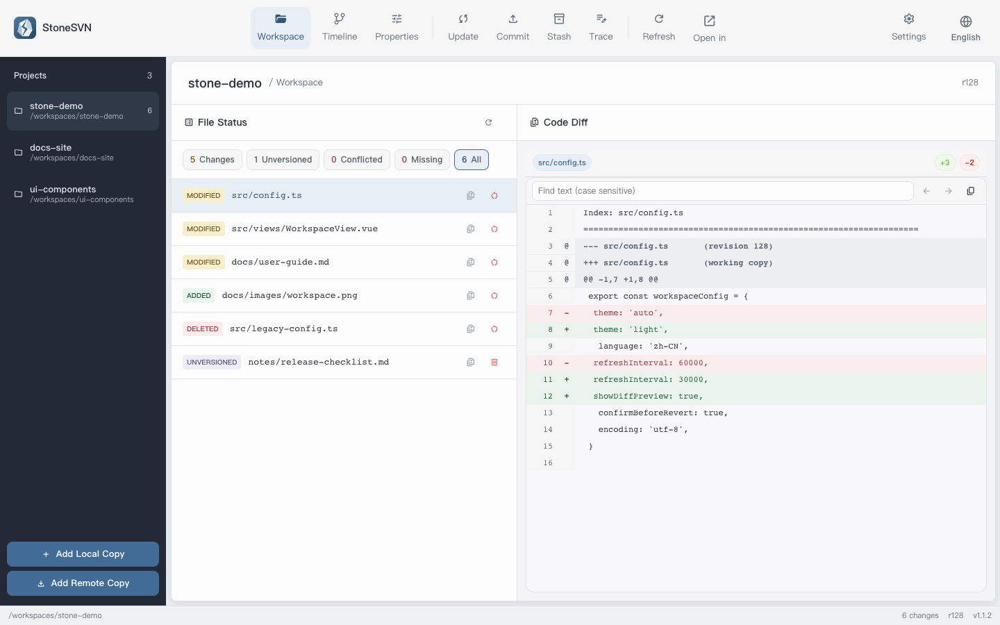
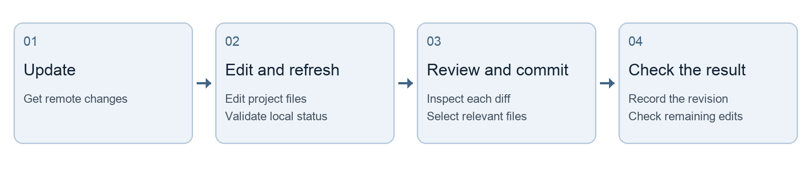
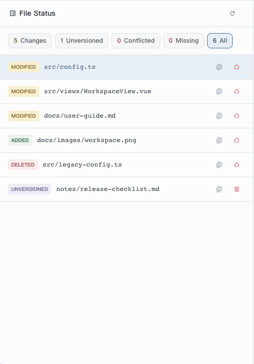
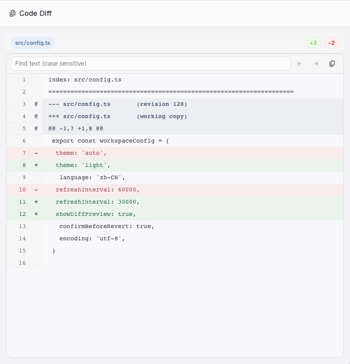
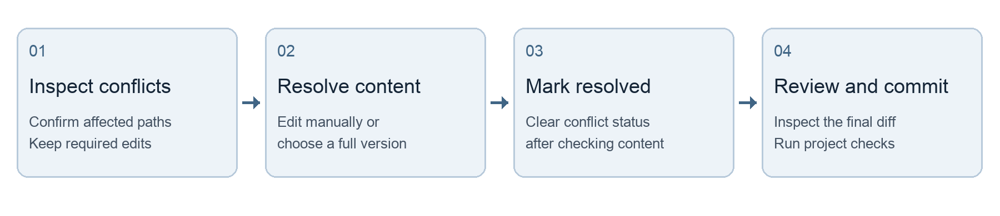
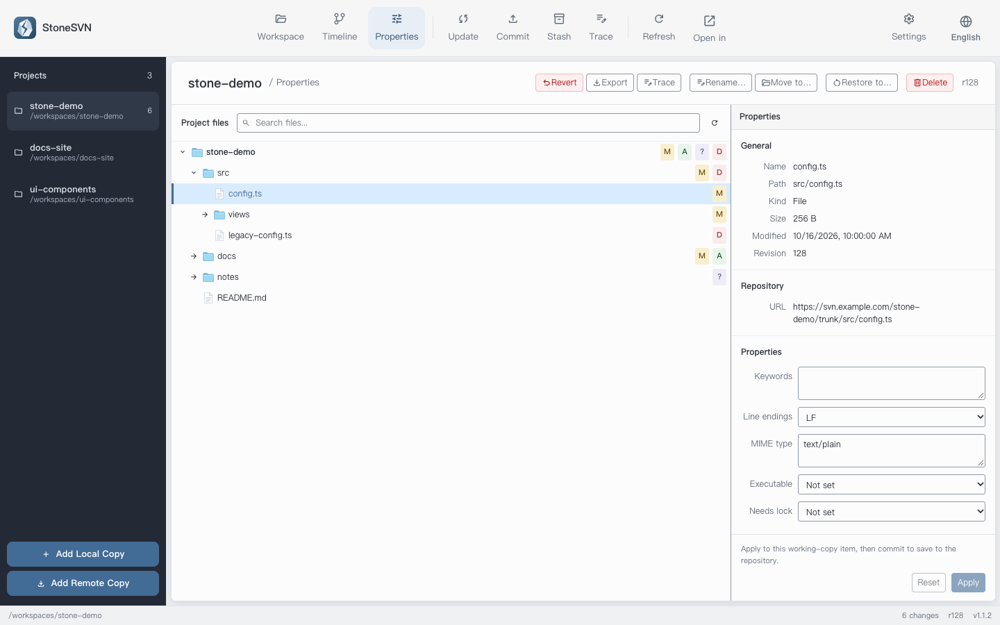
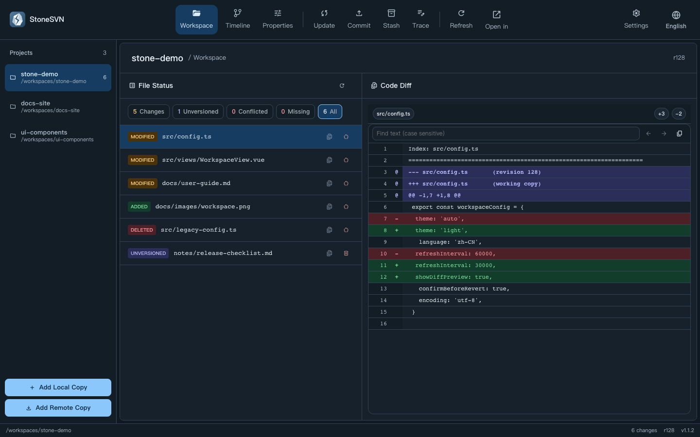

# StoneSVN quick start

English | [简体中文](QUICKSTART.zh-CN.md)

An illustrated guide from opening a project to completing a reviewed commit. See the [user guide](docs/user-guide.md) for the complete interface reference.

Applies to version 1.1.3. Updated: 2026-10-19.

This guide is for new StoneSVN users and anyone looking up everyday steps. Follow the environment setup, workspace, update, and commit sections in order to complete your first change. Use the conflict and stash sections when those situations arise.

Before changing anything, confirm the project and file status, inspect the diff, and select only the changes needed for the current task. Refresh, Update, Commit, and Revert have different effects.



## Contents

- [Prepare the environment and open a project](#prepare-the-environment-and-open-a-project)
- [Understand the workspace and file status](#understand-the-workspace-and-file-status)
- [Update and review diffs](#update-and-review-diffs)
- [Select files and commit](#select-files-and-commit)
- [Resolve conflicts and revert carefully](#resolve-conflicts-and-revert-carefully)
- [Stash unfinished work](#stash-unfinished-work)
- [Manage files and directories in Properties](#manage-files-and-directories-in-properties)
- [Browse history and configure the interface](#browse-history-and-configure-the-interface)
- [Troubleshooting and command reference](#troubleshooting-and-command-reference)

Screenshots show the 1.1.2 development interface with fictional workspace data. Paths, revisions, repository addresses, and code are examples. The screenshots use the English interface, matching the instructions below.

## Prepare the environment and open a project

### Check the SVN executable

StoneSVN uses the locally installed SVN CLI. It does not replace an SVN server or create a remote repository when you open a normal folder. Prepare the repository URL, access permissions, and a local destination supplied or approved by your team.

Run:

```bash
svn --version --quiet
```

A working installation prints a version number. If StoneSVN cannot find SVN, set SVN Executable in Settings to the executable file, not its installation directory. Leave it empty to use `svn` from the system environment.

### Open an existing working copy

1. Select Add Local Copy at the bottom of the project sidebar and choose an existing SVN working copy. Older documentation calls this Open Workspace.
2. Prefer the working-copy root containing `.svn` metadata. A downloaded ZIP or ordinary folder is generally not a working copy.
3. Wait for status validation, then verify the path and file list. Check the full path before working with similarly named projects.

### Check out a project for the first time

Select Add Remote Copy to open Checkout. Fill in the fields and start checkout. This creates a local working copy that you can subsequently select from the project sidebar.

| Field | Example and checks |
| --- | --- |
| Repository URL | `https://svn.example.com/repo/trunk`; use the team's full URL and check the project or branch. |
| Destination | Use a dedicated local directory to avoid mixing existing project content. |
| Revision | Leave empty for the latest revision, or enter an explicit historical revision. |

### Follow the daily workflow



You are ready when the project appears in the sidebar, status validation succeeds, and you can select a file to inspect its diff. If a connection fails, read the error before checking the URL, network, and permissions.

## Understand the workspace and file status

The workspace focuses on files requiring attention, so it may omit unchanged files. Switch projects on the left and tools at the top. Filter status in the middle and inspect the selected file's diff on the right. Properties provides a more complete project tree.



| Status | Meaning | Next step |
| --- | --- | --- |
| Modified M | A versioned file has local changes | Review its diff, then commit, stash, or revert. |
| Added A | Scheduled for version control | Check the content and commit; it has not yet been uploaded. |
| Deleted D | Scheduled for versioned deletion | Confirm the scope, then commit or revert. |
| Replaced R | An existing entry is replaced by a new entry | Check the complete operation and directory relationships. |
| Unversioned ? | Exists locally but is not versioned | Add it before committing if it should be shared. |
| Conflicted C | SVN cannot reconcile changes automatically | Resolve the content, then mark it resolved. |
| Missing ! | A versioned item is absent from disk | Restore it or schedule its versioned deletion. |

### Understand cached status

Reopening a workspace may show a cached list before validating disk state. While the cache or unverified notice is visible, wait for validation. Commit, stash creation, and workspace revert/delete actions are temporarily disabled. Refresh performs a complete check. If validation fails, address the error rather than treating the old list as current.

Moving a versioned file directly in a file manager can produce Missing status. Deleted means SVN has scheduled a deletion. Decide which outcome you intend before proceeding.

## Update and review diffs

### Get remote changes

1. Confirm the project path. Save editor content and, if necessary, back up or stash supported unfinished changes.
2. Open Update and select Check to inspect local/remote revisions and the listed commits.
3. Select Update and wait. It retrieves remote changes and may merge local edits or create conflicts.
4. Return to the workspace and inspect the result. Resolve conflicts using the section below, then review your local diff even if the update was clean.

Incoming commits are selected from actual remote file and property changes using each node’s BASE revision. Commits already present locally are excluded even when the working-copy root has an older revision. A failed check leaves update availability unknown; retry before concluding that no updates are available. Remote checks reuse the saved security settings for the matching server.

Refresh checks local state; Update retrieves remote files. The remote commit count describes the records currently listed, not the repository's entire history. Updating does not commit your local work.

### Read the diff



Select a workspace file to read the diff. The example changes the theme and refresh interval and adds a preview option. Inspect values and surrounding context, including accidental debug output, temporary configuration, or unrelated formatting changes.

Compare the working copy against its base, compare two explicit revisions, or open a commit diff from the timeline. Revision comparisons require both revision numbers. Search is case-sensitive and supports previous/next matches; Copy copies the complete diff.

Binary files may not have a line-by-line diff. No differences, unsupported text display, and loading errors are different outcomes. Check the message and file type, and use the appropriate editor when necessary.

## Select files and commit

Commit sends the selected local changes to the repository and creates a new revision. Keep each commit focused on one complete task so it is easier to review and investigate. Ordinary unselected changes remain local.

### Steps

1. Open Commit and check the workspace path and file tree.
2. Select the relevant files. Use directory selection controls deliberately; expanding a node or selecting Diff does not toggle selection.
3. Inspect every diff. Use Previous/Next to review multiple files and return to Commit afterward.
4. Check Selected/Total and any hidden-selection notice to exclude files from other tasks.
5. Write a commit message, submit, and wait for an explicit success result. Record the revision, then refresh and check remaining changes.

### Search does not clear selection

Selected items hidden by search or a status filter remain included. The header checkbox covers the entire current commit scope, including filtered-out items. Scrolling and collapsing directories do not clear selections. Do not infer commit scope only from visible rows.

### Add new files before committing

Unversioned files must first be scheduled for addition. For a new directory, use Add to Version Control and Preview to inspect its content and exclude logs, build output, and temporary files. Cancelling a commit after adding may leave scheduled additions in the working copy; check afterward.

### Describe the change and reason

Suppose you are fixing the default connection timeout in `app.ini` while also making unrelated interface edits. Select only the configuration file and use a message such as:

```text
Correct the default connection timeout

Use the team-agreed default to avoid timing out the first connection too early.
```

Recent messages can be reused, but adapt them to the actual change. Directory deletions, replacements, copies, and moves require their complete related scope. Follow directory-selection warnings rather than bypassing them.

### Confirm the result

Check the operation result, revision, and refreshed status together. Other uncommitted files may correctly remain visible. After a failure or interrupted connection, retain the full error and inspect workspace state and the timeline before retrying.

## Resolve conflicts and revert carefully

A conflict means SVN cannot automatically reconcile local and remote changes. The goal is correct final content. Marking resolved only clears conflict status; it does not validate the content or commit it.



### Choose a resolution

| Choice | Use when | Check first |
| --- | --- | --- |
| Keep current content | You have manually completed the merge | Remove conflict markers, save, and inspect the final content. |
| Use local version | You want the complete local-side version | It replaces the entire file and conflicted properties; check which remote changes will be discarded. |
| Use repository version | You want the complete repository-side version | It replaces the entire file and conflicted properties; check which local changes will be discarded. |

1. Select Resolve Conflicts from the workspace conflict list or Properties. Read the affected paths and prompt.
2. For a manual merge, edit the conflicting sections, remove markers such as `<<<<<<<`, `=======`, and `>>>>>>>`, and retain the required content from both sides.
3. Choose the appropriate resolution. Organize directory/tree conflicts manually before marking them resolved.
4. Refresh, inspect the final diff, run the project's required checks, and commit the resolution separately.

### Revert and restore a revision are different

Revert Local Changes discards uncommitted changes; it does not undo repository history. Recursive directory revert affects descendants. Inspect the affected-file preview first, including unversioned content that may be affected inside copied or moved directories. Back up work you need, or stash it only after confirming the supported scope.

Restore To restores historical content as local changes that require review and a separate commit. Directory restoration requires a clean, complete, single-revision directory. Do not use it as a shortcut to discard current work.

Deleting an unversioned file permanently removes the local target, including directory contents, without using the recycle bin. A scheduled versioned deletion enters repository history only after a commit.

## Stash unfinished work

Use a stash when editing text files and temporarily interrupting a task. Stashes live in local application data and are associated with a workspace path. They are neither repository commits nor shared team backups. Commit important work or keep an independent backup.

### Create a stash

1. Open Stash and select Create Stash to inspect supported content.
2. Select whole files or text hunks. Select unversioned files and directories as whole files.
3. Use a recognizable name, such as “Connection timeout fix in progress”.
4. Select Save and Remove from Working Copy. Selected changes are removed after saving; unselected changes remain.
5. Refresh the workspace and verify its actual state rather than relying on the stash name.

### Check before restoring

Return to the original workspace path and check for subsequent edits. After applying, review the diff for unintended mixing with your current task. If applying fails, inspect the result before trying again.

| Operation | Working-copy effect | Stash record |
| --- | --- | --- |
| Apply | Attempts to restore content | Retained for checking. |
| Pop and Delete | Restores content when application succeeds | Deleted after success. |
| Delete | Does not restore or change the working copy | Deleted. |
| Copy/export patch | Exports only the text patch | Separately stored unversioned content is not included. |

### Check supported content

Use the actual preview as the authority. Conflicted versioned files, property-only changes, and non-text versioned changes are not supported by this stash flow. Restored unversioned files remain unversioned. A stash containing only unversioned files may have no text patch to export.

For example, if you edited `config.ts` and created `notes.txt`, select both the text changes and the unversioned file. Exporting only the patch does not back up `notes.txt`.

If the message says the stash was saved but changes could not be removed, the record exists while local changes may remain. Refresh and compare scope before continuing. Records do not automatically follow a moved workspace path. Clearing application data can also remove stashes.

## Manage files and directories in Properties

Properties shows the file tree, basic metadata, repository URL, and SVN properties. Rename, move, revert, and delete act on the selected target. Check the selected path first to avoid applying a directory action to an entire project.



### Commit renames and moves separately

Use Rename or Move To in Properties to preserve SVN history. Enter a complete destination path relative to the working-copy root, including the filename. The destination parent must already be versioned. Inspect old/new paths and descendant status, then commit the complete change. Directory moves cannot be split arbitrarily.

### Properties and additions

Property edits are applied locally and saved to the repository by a later commit. Properties can add unversioned items and cancel ordinary scheduled additions while retaining files. Copied or moved additions are not ordinary additions and cannot be cancelled this way.

### Relocate a repository address

Select Relocate Repository URL from workspace repository information and enter the new full URL corresponding to this working copy. This is for moving the same repository; SVN validates its identity. It neither switches branches nor automatically relocates external working copies.

Switch and general-purpose Merge have no dedicated interface. Complete them in another SVN client or CLI, then refresh StoneSVN.

## Browse history and configure the interface

### View committed changes in the timeline

Timeline shows 20 commits per page with Previous/Next navigation. Combine author, keyword, and date filters, then select Query. If nothing matches, inspect the conditions or Reset them. Hover over truncated authors/messages to see the full text.

Open a commit to inspect its full message and changed paths, then select a file to view that commit's diff. Uncommitted edits belong in the workspace; the timeline shows repository history.

### Trace a file's history

In Trace, select or enter a file within the current workspace and load its revisions, authors, dates, and messages. Open a record's diff from there. This is file commit history, not a line-by-line annotation view. For the last author of each line, use `svn blame` or another client supporting annotations.



### Common settings

Themes include Light, Dark, and System. Languages include Simplified Chinese, Traditional Chinese, English, Japanese, and Korean. Default encoding affects decoding; it does not convert project files. If text looks wrong, check its actual encoding rather than reverting changes.

File filtering is local and global across workspaces, and disabled by default. Enabled matches disappear from change lists and commit candidates without changing SVN versioning or update behavior. The default `.gitignore` rule filters that file itself, not the rules inside it. Check filters and status categories when a file seems missing.

Distinguish authentication, TLS, and certificate failures. Approve compatibility or certificate exceptions only for trusted servers. Remove saved exceptions in Remembered Servers to validate the next connection again.

Diff viewers provide − / + text-size controls (10–28px), shared across views and remembered after restarting. Commit rows also offer Revert and Trace when supported; double-click a file to compare. After committing, the page keeps the output visible.

## Troubleshooting and command reference

### Diagnose by symptom

| Symptom | Checks |
| --- | --- |
| SVN not found | Check its terminal version, set the executable path, then restart. |
| Not a working copy | Check the directory and `.svn`; check out the project first if needed. |
| Actions unavailable | Check cache validation, in-progress operations, and applicable selection. |
| File missing from the list | Check workspace path, status category, file filtering, then refresh. |
| Working copy locked | Confirm no other SVN command is running, then use Cleanup; retain persistent errors. |
| Conflict after update | Inspect paths, organize content, mark resolved, review, and commit. |
| Authentication/connection failure | Check URL, permissions, network, and certificates using the original error. |
| Stash missing | Return to the creation path and check whether application data was cleared. |

### Actions and commands

| Action | Command or behavior |
| --- | --- |
| Refresh | Check local state, primarily with `svn status`; no remote file update. |
| Update | `svn update`; retrieve remote changes, possibly merging or conflicting. |
| Commit | `svn commit`; send selected changes and create a revision. |
| Diff | `svn diff`; compare the selected content/revisions. |
| Timeline/file history | `svn log`; query committed records. |
| Revert local changes | `svn revert`; discard uncommitted changes. |
| Line annotations | `svn blame`; use the CLI or another supporting client. |

Before committing, confirm the project path, validated state, reviewed diff, selected scope, and message. Record the revision and inspect remaining changes afterward.

When reporting a problem, include application version, operating system, reproduction steps, expected result, and the complete error. Remove passwords, tokens, sensitive URLs, and project content before sharing screenshots or reports.

### Related resources

- [Downloads](https://github.com/firzen/StoneSVN/releases)
- [Issue tracker](https://github.com/firzen/StoneSVN/issues)
- [Complete user guide](docs/user-guide.md)
