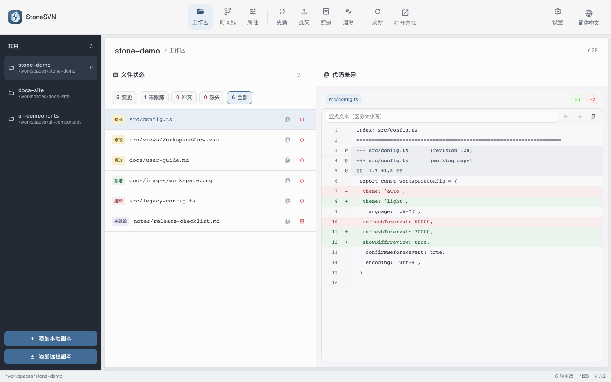
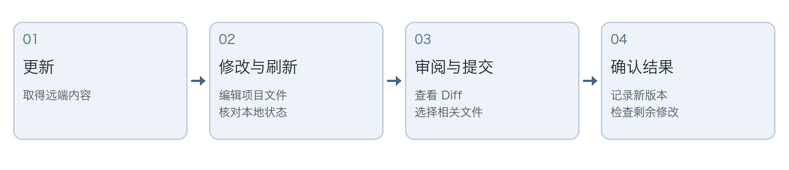
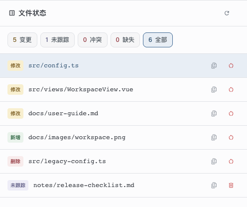
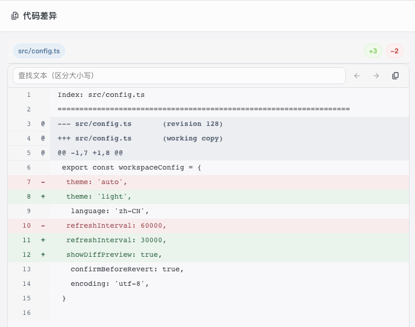
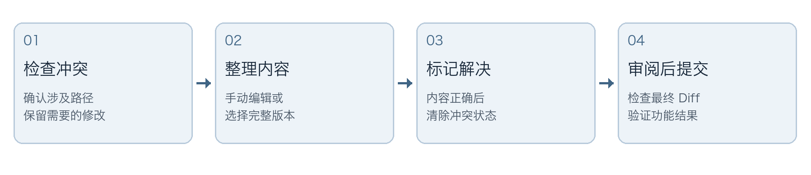
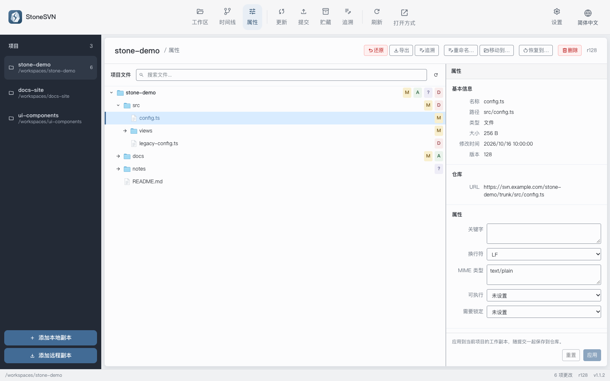
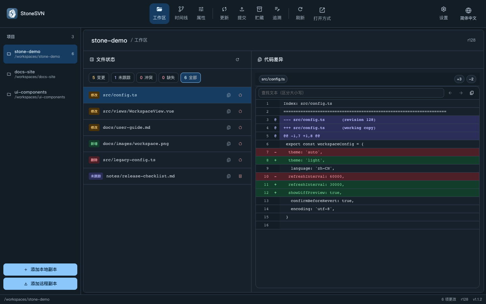

# StoneSVN 快速使用指南

[English](QUICKSTART.md) | 简体中文

从打开项目到完成一次可靠提交的图文操作指南。完整界面说明还可参阅[用户手册](docs/user-guide.zh-CN.md)。

适用版本：1.1.3。更新日期：2026-10-19。

这份指南面向第一次使用 StoneSVN 的项目成员，也适合需要快速查找操作步骤的日常用户。按“准备环境”至“选择文件并完成一次提交”的顺序操作，可以完成准备环境、打开项目、审阅修改和提交；遇到冲突或需要暂存工作时，再查阅对应章节。

日常操作的关键是先确认项目和文件状态，再审阅差异，只提交当前任务需要的变更。刷新、更新、提交和还原各有不同作用，不能互相替代。



## 阅读路线

- [准备环境并打开项目](#准备环境并打开项目)
- [看懂工作区与文件状态](#看懂工作区与文件状态)
- [先更新再审阅代码差异](#先更新再审阅代码差异)
- [选择文件并完成一次提交](#选择文件并完成一次提交)
- [处理冲突与谨慎还原](#处理冲突与谨慎还原)
- [临时中断任务时使用贮藏](#临时中断任务时使用贮藏)
- [在属性页管理文件和目录](#在属性页管理文件和目录)
- [查询历史并调整显示设置](#查询历史并调整显示设置)
- [常见问题与操作速查](#常见问题与操作速查)

截图说明  界面图来自项目内的 1.1.2 开发界面，使用虚构工作区数据；路径、版本号、仓库地址和代码仅用于演示。

## 准备环境并打开项目

### 先确认 SVN 命令可用

StoneSVN 调用本机 SVN 命令行工具完成版本控制操作，需要先安装 SVN。它不代替服务端，也不会因为打开普通文件夹就创建远端仓库。连接项目之前，准备团队提供的仓库 URL、访问权限和本地保存位置。

在终端运行以下命令，确认 SVN 已可用：

```bash
svn --version --quiet
```

正常时应输出版本号。若软件提示找不到 SVN，在“设置”的“SVN 可执行文件”中填写实际程序文件路径，而不是安装目录；留空时使用系统环境中的 svn。

### 已有本地工作副本

1. 点击左侧项目栏底部的“添加本地副本”，选择已经检出的 SVN 项目目录。旧版文档可能称为“打开工作区”。

2. 优先选择含有 `.svn` 元数据的工作副本根目录。普通下载目录、解压目录通常不是工作副本。

3. 等待状态验证完成，核对项目路径与文件列表。多个相似项目并存时，先看完整路径再操作。

### 第一次从仓库取得项目

点击“添加远程副本”进入检出页面，填写下列内容后开始检出。检出会在本地建立工作副本，之后可以直接从项目栏进入。

| 字段 | 填写示例与核对要点 |
| --- | --- |
| 仓库 URL | https://svn.example.com/repo/trunk<br>使用团队提供的完整地址，确认指向正确项目或分支。 |
| 目标目录 | 选择专用本地目录，避免与已有项目内容混用。 |
| 版本 | 留空取得最新版本；需要历史快照时输入明确的版本号。 |

### 掌握一次完整操作的顺序



完成标志  项目出现在左侧列表，状态核对成功，能够选择文件查看差异。若连接失败，先阅读错误，再检查 URL、网络和权限。

## 看懂工作区与文件状态

工作区集中显示需要关注的文件，不一定列出所有正常文件。左侧用于切换项目，顶部用于切换功能，中间按状态筛选，右侧显示所选文件的 Diff。属性页可查看较完整的项目文件树。



| 状态 | 含义 | 下一步 |
| --- | --- | --- |
| 修改 M | 受控文件有本地变化 | 检查 Diff，再提交、贮藏或还原 |
| 新增 A | 已安排加入版本控制 | 确认内容后提交；尚未上传仓库 |
| 删除 D | 已安排受控删除 | 核对范围，再提交或还原 |
| 替换 R | 原条目被新条目替换 | 检查完整操作及目录关系 |
| 未跟踪 ? | 文件在磁盘上但未受控 | 需要共享时先加入版本控制 |
| 冲突 C | SVN 无法自动协调变化 | 处理内容，再标记解决 |
| 缺失 ! | 受控文件在磁盘上不存在 | 恢复文件或安排版本控制删除 |

### 缓存提示意味着什么

重新进入工作区时，软件可能先展示缓存文件列表，再核对磁盘状态。出现缓存或未验证提示时，先等验证结束；提交、创建贮藏及工作区还原／删除会暂时禁用。点击刷新可执行完整核对；验证失败时按错误处理，不能把旧列表当作最新结果。

辨别缺失与删除  在文件管理器中直接移走受控文件，可能形成“缺失”；经过 SVN 安排的删除才是待提交的“删除”。先判断意图，避免误把缺失当作已经安排完成的删除。

## 先更新再审阅代码差异

### 更新远端内容

1. 确认当前项目路径。若已有尚未完成的工作，先保存编辑器内容，并按需要备份或贮藏支持的修改。

2. 进入“更新”，点击“检查”，查看本地版本、远端版本和列出的提交记录。

3. 点击“更新”，等待操作结束。更新会取得远端变化，可能合并本地修改，也可能产生冲突。

4. 返回工作区检查结果。出现冲突时先按“处理冲突与谨慎还原”一节处理；没有冲突也应继续检查本地 Diff。

刷新核对本地状态，更新才会取得远端文件。更新页列出的远端提交数量不代表仓库历史总数；更新成功也不会自动提交你的本地修改。

### 用 Diff 确认改了什么



选择工作区中的文件，阅读右侧差异。示例中主题和刷新间隔发生变化，并新增预览开关。审阅时既要确认数值，也要检查相邻上下文，判断是否带入调试输出、临时配置或无关格式变化。

常用比较包括“工作副本 vs 基准”、两个明确版本之间的差异，以及从时间线进入某次提交的差异。版本间比较需要填写两个版本号。行内查找区分大小写，可通过上一个／下一个匹配定位；复制按钮可复制完整 Diff。

二进制文件不一定能展示逐行差异。没有差异、无法显示文本和加载失败是不同结果，应结合提示与文件类型判断，必要时用对应编辑器检查。

## 选择文件并完成一次提交

提交将选中的本地变更发送到仓库，成功后产生新的仓库版本。一次提交尽量对应一个完整任务，便于审查、查错和以后追踪原因。未勾选的普通修改继续保留在本地。

### 操作步骤

1. 打开“提交”，先核对当前工作区路径和文件树。

2. 勾选本次任务涉及的文件。目录行会联动子项，展开箭头和“对比”按钮不会改变勾选。

3. 逐个检查差异。审阅多个文件时使用上一个／下一个，完成后返回提交页。

4. 检查顶部“已选／总数”和隐藏选择提示，确认没有混入其他任务的文件。

5. 填写提交说明，点击提交，等待明确的成功结果。记录新版本号，再刷新检查剩余修改。

### 搜索和筛选不会取消选择

被搜索条件或状态分类隐藏的已选项目仍会提交。表头全选作用于当前提交范围中的全部项目，包括被筛选隐藏的项目。滚动或折叠目录也不会取消选择，因此不能只根据当前屏幕可见行判断提交范围。

### 新文件需要先加入版本控制

未跟踪文件必须先安排加入。遇到未跟踪目录，使用“加入版本控制并预览”检查其内容，避免把日志、构建产物或临时文件带入。安排新增后即使取消本次提交，新增状态仍可能保留，需回工作区检查。

### 写清改动与原因

示例任务  修改 `app.ini` 的默认连接超时时间，同时本地另有未完成的界面调整。只勾选配置文件，说明可写为：

```text
修正默认连接超时时间

将默认值调整为团队约定值，避免首次连接过早超时。
```

最近提交信息可以回填，但应改成符合本次变更的说明。删除、替换、复制或移动目录时，要完整选择所需范围；软件提示无法部分提交时，按目录关系处理，不要绕过检查。

### 提交后如何判断成功

以操作结果、生成的版本和刷新后的状态共同判断。尚未提交的文件继续显示是正常情况。若提交失败或网络中断，保留完整错误，先核对工作区与时间线，再决定下一步，避免直接重复提交。

## 处理冲突与谨慎还原

冲突表示本地变化和远端变化无法自动协调。解决冲突的目标是得到正确的最终文件；“标记解决”只是清除冲突状态，不代表内容已经正确，也不会自动提交。



### 选择合适的解决方式

| 方式 | 适用情况 | 执行前核对 |
| --- | --- | --- |
| 保留当前内容 | 已手动编辑并完成合并 | 清除冲突标记，保存文件并检查最终内容 |
| 使用本地版本 | 确认采用本地一侧的完整版本 | 会替换整个文件及冲突属性，检查是否舍弃所需远端变化 |
| 使用仓库版本 | 确认采用仓库一侧的完整版本 | 会替换整个文件及冲突属性，检查是否舍弃所需本地变化 |

1. 在工作区冲突列表或属性页选择“解决冲突…”。先阅读涉及路径与提示。

2. 手动合并时，在编辑器处理冲突段，删除 `<<<<<<<`、`=======`、`>>>>>>>` 等冲突标记，保留双方需要的内容。

3. 选择对应的解决方式。目录或树冲突先整理文件和目录关系，再标记解决。

4. 刷新确认状态，查看最终 Diff，并执行项目所需的功能检查，之后单独提交解决结果。

### 还原本地修改与恢复历史版本不同

“还原本地修改”丢弃尚未提交的变更，不会撤销已经存在的仓库历史。目录递归还原会影响子项，执行前应查看影响范围；复制或移动目录中还可能存在会受影响的未跟踪内容。需要保留的工作先独立备份，或确认符合贮藏范围后保存。

“恢复到…”把历史内容恢复成当前工作副本的本地变化，需要审阅并另行提交。目录恢复要求目录干净、完整且版本一致，不应当把它当作放弃当前修改的快捷方式。

删除未跟踪文件会永久删除本地目标，目录内容也会一并删除，不进入回收站。受控文件的安排删除则需要提交后才进入仓库历史，两种操作应分别判断。

## 临时中断任务时使用贮藏

贮藏适合正在修改文本文件、临时需要切换工作的场景。它按工作区路径保存在本机软件数据中，不是仓库提交，也不是团队共享备份。重要工作仍应提交或保存独立备份。

### 创建贮藏

1. 打开“贮藏”，点击“创建贮藏”，查看可以保存的内容。

2. 按文件或文本分块选择要暂存的修改；未跟踪文件和目录按整文件选择。

3. 填写能识别任务的名称，例如“连接超时修复 进行中”。

4. 点击“保存并从工作副本移除”。成功后，选中的改动从工作副本移除，未选中的内容继续保留。

5. 回到工作区刷新，确认当前任务需要的干净程度，不要仅凭贮藏名称判断已保存范围。

### 恢复时先核对工作区

回到创建贮藏时的工作区路径，检查当前文件是否又发生变化。应用后审阅 Diff，确认没有混入当前任务不需要的内容。应用失败时先检查实际残留，不要连续重复应用。

| 操作 | 恢复到工作副本 | 贮藏记录 |
| --- | --- | --- |
| 应用 | 尝试恢复保存内容 | 保留，便于核对 |
| 弹出并删除 | 应用成功后恢复内容 | 成功后删除 |
| 删除 | 不恢复，也不改变当前工作副本 | 删除记录 |
| 复制或导出 patch | 只取得文本补丁部分 | 不会导出另存的未跟踪文件内容 |

### 开始前确认支持范围

可选内容以界面预览为准。受控文件的冲突、仅属性修改和非文本变更暂不支持按此方式贮藏；未跟踪文件恢复后仍保持未跟踪状态。仅保存未跟踪文件时，可能没有可导出的文本 patch。

示例  当前修改了 `config.ts`，同时新建 `notes.txt`。若两者都需暂存，应分别核对文本修改和未跟踪文件是否勾选；只导出 patch 不能代替备份 `notes.txt`。

若提示“贮藏已保存，但未能从工作副本移除改动”，说明记录已经保存，但原目录可能仍有修改。先刷新并比对范围，再处理后续工作。移动工作区路径后记录不会自动跟随；清理软件本地数据也可能使记录丢失。

## 在属性页管理文件和目录

属性页适合查看文件树、基本信息、仓库 URL 和 SVN 属性，并对选中的受控目标执行重命名、移动、还原或删除。操作前先核对树中的选中路径，避免把目录操作误用于整个项目。



### 重命名和移动后仍要提交

使用属性页的“重命名…”或“移动到…”可保留 SVN 历史。移动目标填写相对于工作副本根目录的完整路径，包含目标文件名；目标父目录应已纳入版本控制。完成后检查新旧路径与子项状态，再提交完整变更。移动目录不支持任意拆分提交。

### 属性与加入版本控制

属性修改先应用到本地工作副本，再随提交保存到仓库。未跟踪项目可以在属性页加入版本控制；普通新增计划也可取消并保留本地文件。复制或移动形成的新增不属于普通新增，不能按同样方式取消。

### 仓库搬家时使用地址迁移

在工作区仓库信息中选择“迁移仓库地址…”，填写当前工作副本对应的新完整 URL。此操作仅适用于同一仓库搬迁，SVN 会校验仓库身份；它不切换分支，也不会自动迁移外部工作副本。

功能边界  切换分支 Switch 和通用合并 Merge 暂无独立界面入口，使用其他 SVN 客户端或命令行完成后，回到 StoneSVN 刷新。

## 查询历史并调整显示设置

### 时间线用来查看已提交变化

进入“时间线”，默认每页显示 20 条提交，使用上一页／下一页浏览。作者、关键词与日期范围可以组合筛选，填写后点击查询；无结果时先检查条件，再用重置清除筛选。长作者名和说明省略显示，可悬停查看全文。

点击提交记录查看完整说明和涉及路径，再选择文件查看这次提交的差异。查尚未提交的修改要回工作区；时间线只展示已经进入仓库的历史。

### 追溯按文件查看历史

在“追溯”中选择或输入当前工作区内的文件，点击加载，可查看该文件的版本、作者、时间和提交说明，并进入对应差异。当前页面是文件提交历史视图；需要逐行定位最后修改者时，使用 SVN CLI 的 `svn blame` 或其他支持逐行注解的客户端。



### 常用设置

主题支持浅色、深色和跟随系统；语言支持简体中文、繁体中文、英语、日语、韩语。默认编码影响相关内容解码，不会自动转换项目文件；出现乱码时先确认实际编码，不要用还原尝试修复显示。

文件过滤为本机全局规则，默认关闭。启用后匹配文件不出现在变更列表和提交候选中，但不改变 SVN 受控状态或更新行为。默认 `.gitignore` 只过滤该文件本身，不读取其中规则；遇到“文件不见了”，先检查状态分类和过滤开关。

连接提示应分别判断账号、TLS 与证书问题。仅对可信服务器确认兼容或证书例外；可在“已记住的服务器”中移除记录，下一次连接会重新验证。

## 常见问题与操作速查

### 按现象排查

| 现象 | 检查顺序 |
| --- | --- |
| 找不到 SVN | 终端验证版本 → 设置程序文件路径 → 重启软件 |
| 不是工作副本 | 确认目录和 `.svn` 元数据；尚未检出则添加远程副本 |
| 操作按钮不可用 | 检查缓存验证提示、当前操作和是否选择适用目标 |
| 文件未显示 | 核对工作区路径 → 状态分类 → 文件过滤 → 刷新 |
| 工作副本被锁定 | 确认没有其他 SVN 操作在执行，再使用 Cleanup；持续失败保留原始错误 |
| 更新后有冲突 | 检查涉及路径 → 整理内容 → 标记解决 → 审阅并提交 |
| 认证或连接失败 | 核对 URL、账号权限、网络和证书，按原始错误定位 |
| 贮藏记录不见了 | 回到创建时的工作区路径，检查是否清理过软件数据 |

### 操作与命令对应

| 操作 | 对应命令或行为 |
| --- | --- |
| 刷新 | 核对本地状态，核心为 `svn status`；不取得远端文件 |
| 更新 | `svn update`，取得远端变化，可能合并或冲突 |
| 提交 | `svn commit`，发送已选变更并生成仓库版本 |
| 查看差异 | `svn diff`，按选定模式比较内容 |
| 时间线与文件历史 | `svn log`，查询已提交记录 |
| 还原本地修改 | `svn revert`，丢弃未提交变更 |
| 逐行注解 | `svn blame`，使用命令行或支持该功能的客户端 |

完成一次提交前  确认项目路径正确、状态已验证、差异已检查、勾选范围与说明一致。提交后记录版本并检查剩余修改。

反馈问题时提供软件版本、操作系统、复现步骤、预期结果和完整错误文字。附图或对外反馈前，移除密码、令牌、敏感仓库地址与项目内容。

### 相关资料

- [发行下载页](https://github.com/firzen/StoneSVN/releases)
- [问题反馈页](https://github.com/firzen/StoneSVN/issues)
- [完整用户手册](docs/user-guide.zh-CN.md)
