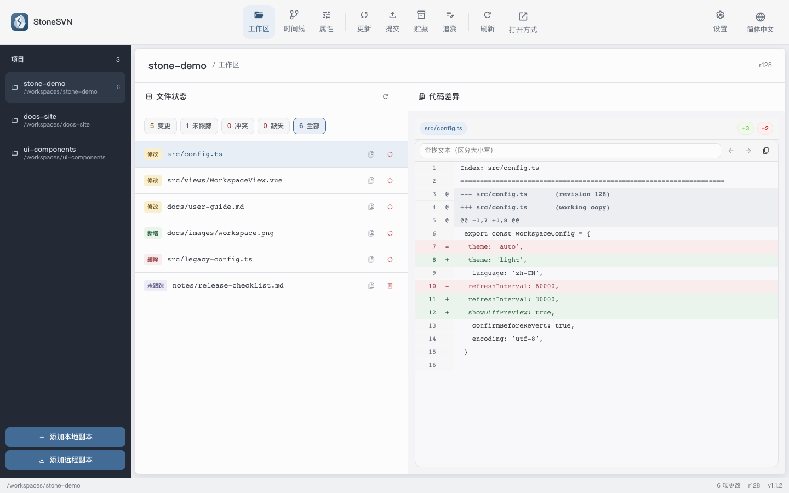
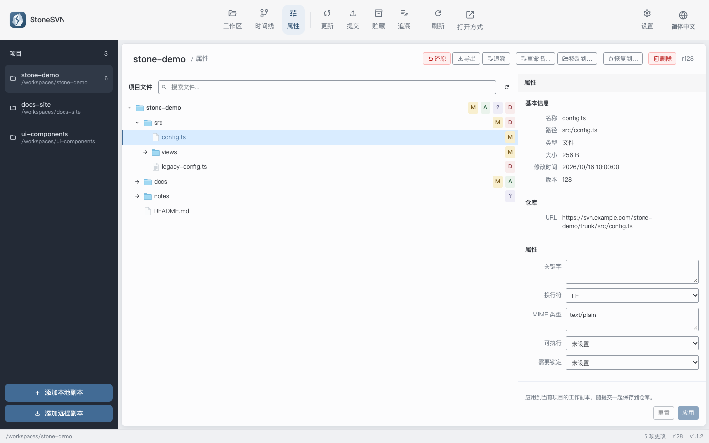

# StoneSVN

[公式サイト](https://stonesvn.github.io)

[简体中文](README.md) | [繁體中文](README.zh-TW.md) | [English](README.en.md) | 日本語 | [한국어](README.ko.md)

StoneSVN は、Tauri、Rust、Vue 3 で構築されたクロスプラットフォーム対応の SVN デスクトップクライアントです。SVN の集中型バージョン管理モデルを維持しながら、Git クライアントのように分かりやすい作業コピー体験を提供します。



現在のソースコードの開発画面です。2026-10-18 に架空のプロジェクト、パス、差分で撮影しました。実際のリポジトリや個人情報は含まれていません。[ダークテーマ](docs/images/orcasvn-workspace-dark.png)。

現在の安定版は **1.1.2** です。[リリースノート](docs/releases/v1.1.2.md)をご覧ください。

## 主な機能

- 常設のプロジェクト一覧から作業コピーを切り替え、ドラッグで並べ替え、一覧の幅を調整。上部ツールバーに主な操作を集約
- `*`、`?`、`**` によるファイルフィルターを設定し、追加とコミット時に対象範囲を検証
- テキスト差分と画像をプレビューし、バイナリファイルやディレクトリを外部アプリで開く
- プロジェクトツリーでファイルやディレクトリの属性を参照し、一般的な SVN 属性と独自のテキスト属性を編集。適用後は別途コミットが必要
- ローカルの変更、バージョン管理外のファイル、競合、欠落ファイルを `git status` のように分類して表示
- チェックアウト、更新、ファイルやディレクトリを選択してコミット、バージョン管理への追加、変更の取り消し、作業コピーのクリーンアップ
- ファイルやテキストの変更ブロックをローカルに一時保存し、元の作業コピーに復元
- コミットのタイムラインとページ分割されたファイル履歴を表示し、過去の差分と前後のリビジョンを確認
- 簡体字中国語、繁体字中国語、英語、日本語、韓国語に対応
- Windows、macOS、Linux、およびライト／ダークテーマに対応

> StoneSVN はローカルにインストールされた `svn` コマンドラインツールを使用し、SVN プロトコル自体は実装していません。

Switch と汎用 Merge は引き続き他の SVN クライアントまたはコマンドラインで行います。競合は手動で解決した内容を保持するか、ローカル／リポジトリ版を選択できます。ディレクトリとツリー競合は先に手動で整理してください。プロパティ画面では履歴を保持する名前変更／移動、影響範囲を確認してからの再帰的な変更取り消し、変更のないファイルやディレクトリの指定リビジョンへの復元、通常の追加予約の取り消しに対応します。変更は別途コミットが必要です。同じリポジトリの移転時には URL の再配置も可能です。

## インストール

[GitHub Releases](https://github.com/firzen/StoneSVN/releases) から Windows、macOS、Linux 用のインストーラーをダウンロードできます。

macOS は Intel Mac 用の `x64` DMG と、Apple Silicon 用の `aarch64` DMG を提供します。「この Mac について」でチップを確認してください。

macOS 版は無料の Ad-hoc 署名を使用し、Apple の公証は受けていません。StoneSVN を「アプリケーション」に移動し、初回起動がブロックされた場合は「システム設定 → プライバシーとセキュリティ → このまま開く」で許可してください。管理対象の Mac では IT 管理者の許可が必要な場合があります。[macOS ビルド・配布ガイド（中国語）](docs/macos-distribution.md)も参照してください。

インストール後、SVN CLI が利用できることを確認してください。

```bash
svn --version --quiet
```

## クイックスタート

1. StoneSVN を開き、プロジェクト一覧下部のローカルコピー追加から既存の作業コピーを開くか、リモートコピー追加からチェックアウトします。
2. ワークスペースで、変更済み、バージョン管理外、競合、欠落の各状態からファイルを絞り込みます。
3. ファイルを選択して Diff を確認し、Commit ページから変更をコミットします。
4. コミット前に Update を実行し、競合がある場合は先に解決します。

詳しい操作方法については [QUICKSTART.md](QUICKSTART.md) を参照してください。

## プロパティ、エクスポート、ファイル履歴

プロパティ画面ではツリーと再帰検索でファイルを探し、SVN 属性を編集できます。管理対象のファイルやディレクトリを新規ディレクトリにエクスポートすると、ローカルの変更を保持し、`.svn` メタデータを除外します。削除予約や、ローカル変更のない管理対象ファイルの指定リビジョンへの復元後は、確認して別途コミットします。ファイル履歴の行をダブルクリックすると差分を確認できます。



[ダークテーマ](docs/images/stonesvn-properties-dark.png)。

## ローカル開発

必要な環境：

- Node.js 18 以降
- 最新の安定版 Rust ツールチェーン
- SVN CLI 1.10 以降
- 各プラットフォーム向けの Tauri 2 ビルド依存関係

```bash
npm ci
npm run tauri dev
```

変更を提出する前に、次のコマンドを実行してください。

```bash
npm run check
```

環境設定とトラブルシューティングについては [SETUP.md](SETUP.md)、コントリビューションのガイドラインについては [CONTRIBUTING.md](CONTRIBUTING.md) を参照してください。

## プロジェクト構成

```text
src/                    Vue 3 フロントエンド
  api/                  Tauri コマンドのラッパー
  composables/          再利用可能なワークスペースロジック
  i18n/                 ローカライズリソース
  stores/               Pinia ステート
  views/                アプリケーション画面
src-tauri/src/
  main.rs               Tauri コマンド境界
  svn/executor.rs       SVN プロセスの実行とタイムアウト
  svn/operations.rs     SVN 引数の構築
  svn/parser.rs         XML／テキスト結果の解析
.github/workflows/      リリースワークフロー
```

## 設計原則

- **予測可能：** UI 操作は、可能な限り明確な SVN コマンドに対応します。
- **変更前に確認：** コミットや取り消しの前に、ステータスと差分を表示します。
- **安全な引数境界：** `--` を使用して、ファイル対象とコマンドオプションを分離します。
- **明確なフィードバック：** 診断しやすいよう、エラーには元の SVN コンテキストを保持します。

## ライセンス

[MIT](LICENSE)
